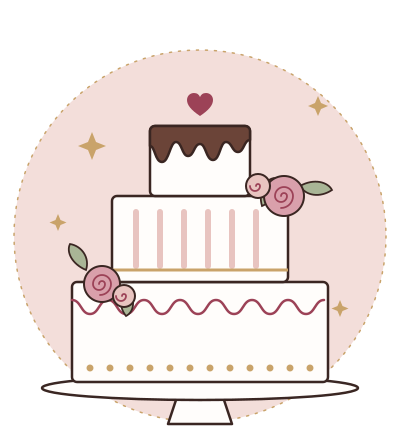

::::: {.hero}
:::: {.wrap}
::: {.hero-text}
[Cake artist · Ottawa]{.eyebrow}

# Des gâteaux uniques, *faits avec passion.*

[Gâteaux personnalisés, pâtisseries françaises et tables sucrées pour mariages, anniversaires et tous les moments qui méritent d'être célébrés. Chaque création est pensée selon votre thème, vos couleurs et vos saveurs préférées.]{.lead}

```{=html}
<div class="actions">
  <a class="btn btn-rose" href="order.html">Commander un gâteau</a>
  <a class="btn btn-line" href="gallery.html">Voir les créations</a>
</div>
<div class="occasions"><span>Mariages</span><span>Anniversaires</span><span>Soirées henné</span><span>Événements</span></div>
```
:::

```{=html}
<div class="hero-art"></div>
```
::::
:::::

::::: {.band}
:::: {.wrap}
::: {.section-head .center}
[Mes créations]{.eyebrow}

## Des douceurs *pour chaque célébration*

Du gâteau d'anniversaire à la table sucrée complète, tout est fait sur commande.
:::

:::: {.grid .g3}
::: {.card}
[]{.ico .i-cake}

### Gâteaux de fête

Anniversaires, baby showers, fiançailles : un gâteau pensé autour de votre thème, de l'élégant au ludique.
:::

::: {.card}
[]{.ico .i-tiers}

### Gâteaux de mariage

Des gâteaux à étages assortis au style de votre mariage, du blanc classique au floral et moderne.
:::

::: {.card}
[]{.ico .i-cube}

### Gâteaux 3D & sculptés

Un gâteau à la forme de ce que vous aimez : un personnage, un objet, une idée. De quoi surprendre.
:::

::: {.card}
[]{.ico .i-slice}

### Cheesecakes

Des cheesecakes onctueux, en gâteau de fête ou sur une table de desserts.
:::

::: {.card}
[]{.ico .i-macaron}

### Pâtisseries & bouchées

Mignardises et bouchées sucrées élégantes pour réceptions, tables de desserts et coffrets cadeaux.
:::

::: {.card}
[]{.ico .i-buffet}

### Buffets sucrés & salés

Soirées henné, réceptions, événements d'entreprise : tables sucrées, bouchées salées et gâteaux traditionnels.
:::
::::

::: {.center}
[Voir toutes les créations](creations.html){.more}
:::
::::
:::::

::::: {.band .bg-blush}
:::: {.wrap .split}
::: {.col}
[Lilya]{.eyebrow}

[Chaque gâteau commence par une conversation : votre histoire, vos couleurs, vos saveurs. Ensuite, je crée quelque chose qui n'existe qu'une seule fois.]{.about-quote}

[Lilya]{.sign}
:::

::: {.col}
Passion Gourmande est l'atelier de Lilya, cake artist installée à Ottawa. Son travail réunit la pâtisserie française et les saveurs des fêtes de famille, du gâteau de mariage au buffet de soirée henné.

Aucune commande ne se ressemble. Parlez-lui de votre événement, partagez quelques photos d'inspiration, et elle imaginera un gâteau qui vous ressemble et qui est encore meilleur qu'il n'est beau.

```{=html}
<div class="actions"><a class="btn btn-dark" href="order.html">Commencer une commande</a></div>
```
:::
::::
:::::

::::: {.band}
:::: {.wrap}
::: {.section-head .center}
[Comment commander]{.eyebrow}

## La commande, *étape par étape*
:::

::: {.steps}
1. **Parlez-moi de votre événement**
   Remplissez le formulaire ou envoyez un message sur Instagram : date, nombre d'invités, idées.
2. **Imaginons-le ensemble**
   Nous choisissons le design, les saveurs et la taille. Les photos d'inspiration sont bienvenues.
3. **Confirmez votre commande**
   Vous recevez un devis personnalisé. La commande est confirmée dès votre accord.
4. **Célébrez**
   Récupérez votre création et profitez du moment avec vos invités.
:::

::: {.callout-box .center}
**Anticipez :** les dates se remplissent vite, surtout pour les mariages et les fêtes. Plus tôt vous écrivez, mieux c'est.
:::
::::
:::::

::::: {.band .bg-cream}
:::: {.wrap}
::: {.section-head .center}
[Dernières créations]{.eyebrow}

## Tout droit *d'Instagram*
:::


::::
:::::

::::: {.cta-band}
::: {.wrap}
## Une fête se prépare ? *Rendons-la gourmande.*

Parlez-moi de votre événement : je vous réponds avec des idées et un devis.

```{=html}
<div class="actions">
  <a class="btn btn-rose" href="order.html">Commander un gâteau</a>
  <a class="btn btn-line" href="https://ig.me/m/passion_gourmande_by_l" target="_blank" rel="noopener">Message sur Instagram</a>
</div>
```
:::
:::::
