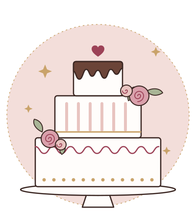

---
format:
  html:
    include-before-body: _partials/header-en.html
    include-after-body: _partials/footer-en.html
title: "Custom cakes & French pastries in Ottawa"
description: "Passion Gourmande by Lilya: one-of-a-kind custom cakes, wedding cakes, 3D cakes, French pastries and sweet tables for weddings, birthdays and special events in Ottawa."
---

::::: {.hero}
:::: {.wrap}
::: {.hero-text}
[Cake artist · Ottawa]{.eyebrow}

# One-of-a-kind cakes, *made with passion.*

[Custom cakes, French pastries and sweet tables for weddings, birthdays and every moment worth celebrating. Each one is designed around your theme, your colours and your favourite flavours.]{.lead}

```{=html}
<div class="actions">
  <a class="btn btn-rose" href="order.html">Order a cake</a>
  <a class="btn btn-line" href="gallery.html">See the creations</a>
</div>
<div class="occasions"><span>Weddings</span><span>Birthdays</span><span>Henna nights</span><span>Special events</span></div>
```
:::

```{=html}
<div class="hero-art"></div>
```
::::
:::::

::::: {.band}
:::: {.wrap}
::: {.section-head .center}
[What I make]{.eyebrow}

## Sweet creations *for every celebration*

From a birthday cake to a full sweet table, everything is made to order.
:::

:::: {.grid .g3}
::: {.card}
[]{.ico .i-cake}

### Celebration cakes

Birthdays, anniversaries, baby showers: a cake designed around your theme, from elegant to playful.
:::

::: {.card}
[]{.ico .i-tiers}

### Wedding cakes

Tiered cakes that match your wedding style, from classic white to floral and modern.
:::

::: {.card}
[]{.ico .i-cube}

### 3D & sculpted cakes

A cake shaped like what you love: a character, an object, an idea. Made to surprise.
:::

::: {.card}
[]{.ico .i-slice}

### Cheesecakes

Creamy cheesecakes, as a celebration cake on their own or on a dessert table.
:::

::: {.card}
[]{.ico .i-macaron}

### French pastries & bites

Elegant mini pastries and sweet bites for receptions, dessert tables and gifts.
:::

::: {.card}
[]{.ico .i-buffet}

### Sweet & savoury buffets

Henna nights, receptions and corporate events: sweet tables, savoury bites and traditional sweets.
:::
::::

::: {.center}
[See all creations](creations.html){.more}
:::
::::
:::::

::::: {.band .bg-blush}
:::: {.wrap .split}
::: {.col}
[Meet Lilya]{.eyebrow}

[Every cake starts with a conversation: your story, your colours, your flavours. Then I make something that exists only once.]{.about-quote}

[Lilya]{.sign}
:::

::: {.col}
Passion Gourmande is the cake studio of Lilya, a cake artist based in Ottawa. Her work brings together French pâtisserie and the flavours of family celebrations, from wedding cakes to henna-night buffets.

No two orders are the same. Tell her about your event, share a few inspiration photos, and she will design a cake that looks like you and tastes even better.

```{=html}
<div class="actions"><a class="btn btn-dark" href="order.html">Start an order</a></div>
```
:::
::::
:::::

::::: {.band}
:::: {.wrap}
::: {.section-head .center}
[How it works]{.eyebrow}

## Ordering, *step by step*
:::

::: {.steps}
1. **Tell me about your event**
   Fill in the order form or send a message on Instagram: date, number of guests, ideas.
2. **Design it together**
   We choose the design, flavours and size. Inspiration photos are welcome.
3. **Confirm your order**
   You receive a personalised quote. Your order is confirmed once you agree.
4. **Celebrate**
   Pick up your creation and enjoy the moment with your guests.
:::

::: {.callout-box .center}
**Plan ahead:** dates fill up quickly, especially for weddings and holidays. The earlier you write, the better.
:::
::::
:::::

::::: {.band .bg-cream}
:::: {.wrap}
::: {.section-head .center}
[Latest creations]{.eyebrow}

## Fresh from *Instagram*
:::


::::
:::::

::::: {.cta-band}
::: {.wrap}
## Have a celebration coming up? *Let's make it sweet.*

Tell me about your event and I'll get back to you with ideas and a quote.

```{=html}
<div class="actions">
  <a class="btn btn-rose" href="order.html">Order a cake</a>
  <a class="btn btn-line" href="https://ig.me/m/passion_gourmande_by_l" target="_blank" rel="noopener">Message on Instagram</a>
</div>
```
:::
:::::
